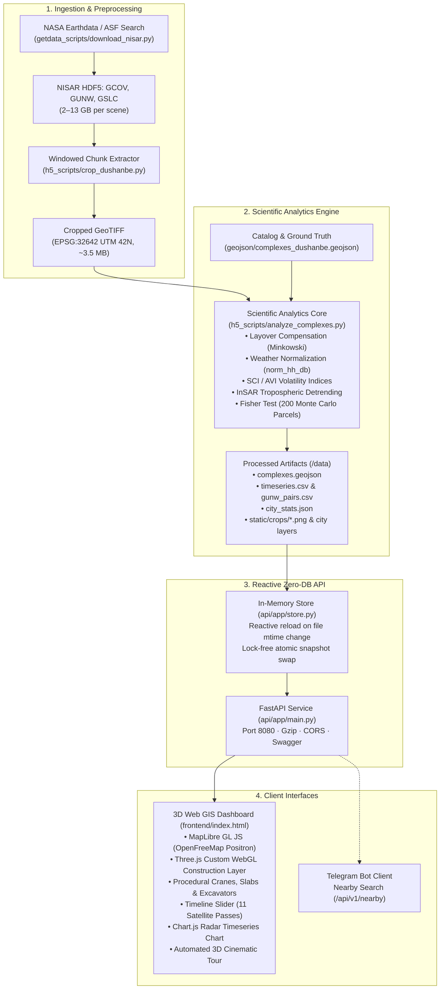

<div align="center">

# 🛰️ SiteSAR

**Spaceborne SAR Monitoring of Construction Dynamics and Ground Stability in Dushanbe**

[](https://www.spaceappschallenge.org/)
[-108554.svg?style=flat-square)](https://nisar.jpl.nasa.gov/)
[](https://www.python.org/)
[](https://fastapi.tiangolo.com/)
[](https://maplibre.org/)
[](https://threejs.org/)
[](https://www.docker.com/)

<p align="center">
  <i>"A satellite radar truth detector verifying if your building is actually rising and whether the ground beneath it remains stable."</i>
</p>

[Overview](#overview) •
[Methodology](#scientific--algorithmic-methodology) •
[Architecture](#system-architecture) •
[Tech Stack](#tech-stack) •
[Quickstart](#getting-started) •
[REST API](#rest-api-reference) •
[Real-World Cases](#validated-cases-in-dushanbe)

---

</div>

## Table of Contents

- [Overview](#overview)
- [Problem & Motivation](#problem--motivation)
- [Earth Observation Data: NASA–ISRO NISAR](#earth-observation-data-nasaisro-nisar)
- [Key Features](#key-features)
- [Scientific & Algorithmic Methodology](#scientific--algorithmic-methodology)
  - [1. Radar Layover Geometric Compensation](#1-radar-layover-geometric-compensation)
  - [2. Adaptive Ring Buffer & Weather Normalization](#2-adaptive-ring-buffer--weather-normalization)
  - [3. Structural Dynamics Indices (SCI and AVI)](#3-structural-dynamics-indices-sci-and-avi)
  - [4. Millimeter-Scale InSAR Ground Deformation Analysis](#4-millimeter-scale-insar-ground-deformation-analysis)
  - [5. Ultra-Detailed Phase Coherence via GSLC (10×5 m)](#5-ultra-detailed-phase-coherence-via-gslc-105-m)
  - [6. Monte Carlo Calibration & Fisher's Combined Probability (Zero False Alarms)](#6-monte-carlo-calibration--fishers-combined-probability-zero-false-alarms)
- [System Architecture](#system-architecture)
- [Tech Stack](#tech-stack)
- [Repository Structure](#repository-structure)
- [Getting Started](#getting-started)
  - [Prerequisites](#prerequisites)
  - [Running with Docker Compose](#running-with-docker-compose)
  - [Local Development Setup](#local-development-setup)
- [Data Pipeline & Processing Guide](#data-pipeline--processing-guide)
  - [1. Ingesting NISAR Scenes from NASA Earthdata](#1-ingesting-nisar-scenes-from-nasa-earthdata)
  - [2. Windowed GeoTIFF Extraction (HDF5 to GeoTIFF)](#2-windowed-geotiff-extraction-hdf5-to-geotiff)
  - [3. Running the Analytics Core](#3-running-the-analytics-core)
- [REST API Reference](#rest-api-reference)
  - [Endpoint Contracts](#endpoint-contracts)
  - [Example Requests & Responses](#example-requests--responses)
- [Interactive 3D Web GIS Interface](#interactive-3d-web-gis-interface)
- [Configuration & Environment Variables](#configuration--environment-variables)
- [Validated Cases in Dushanbe](#validated-cases-in-dushanbe)
- [Team & Project Context](#team--project-context)

---

## Overview

**SiteSAR** is an open-source analytical platform designed for automated, objective monitoring of urban construction progress and geotechnical ground stability across Dushanbe, Tajikistan. Developed by team **Apex Tajikistan** for the **NASA Space Apps Challenge 2026** (challenge: *Dancing with the SARs*).

The platform bridges official development claims and ground reality using Synthetic Aperture Radar (SAR) observations from the **NASA–ISRO NISAR** mission. Operating through persistent cloud cover, haze, and darkness, SiteSAR quantitatively detects the erection of reinforced concrete and steel structures, uncovers stalled or frozen development sites months before official disclosures, and tracks sub-centimeter subsidence under high-rise building footprints.

---

## Problem & Motivation

1. **Urban Construction Boom & Stalled Developments:** Dushanbe is undergoing rapid vertical expansion with dozens of simultaneous high-rise residential complexes. Homebuyers, financial institutions, and municipal regulators lack independent means to verify whether construction is actively advancing or has quietly stalled.
2. **Permit Discrepancies:** On-site hoardings and active advertisements often mask missing urban planning permits or deviations from approved structural specifications.
3. **Seismic & Geotechnical Vulnerability:** Situated in a seismically active tectonic basin, Dushanbe's heavy high-rise foundations place stress on collapsible loess soils. Localized ground subsidence can trigger catastrophic structural fatigue if not detected early.
4. **Failure of Optical Remote Sensing:** Optical satellites (Sentinel-2, Landsat, Planet) are routinely blinded by seasonal clouds, dust storms, and nocturnal conditions. Crucially, optical imagery cannot measure structural dielectric bulk (concrete/rebar volume) or sub-centimeter vertical displacement.

---

## Earth Observation Data: NASA–ISRO NISAR

SiteSAR leverages L-band radar data from the **NASA–ISRO NISAR** mission (**L-band**, center frequency $1.257\text{ GHz}$, wavelength $\lambda = 23.84\text{ cm}$). The longer L-band wavelength penetrates deep into the atmosphere, rain, and dust, providing superior sensitivity to corner reflectors, structural steel framing, and interferometric phase coherence.

The pipeline processes three standard NISAR observation streams (Ascending orbit, track `012`, frame `021`, 12-day repeat cycle):

| Product | Spatial Resolution | Polarization / Channels | Role in SiteSAR |
|---|---|---|---|
| **L2 GCOV** | 20 m (geocoded) | HH, HV ($\gamma^0$, linear units) | Radiometrically calibrated backscatter tracking structural mass changes |
| **L2 GUNW** | 80 m (InSAR geocoded) | `unwrappedPhase` (rad), `coherenceMagnitude` | Cumulative line-of-sight (LOS) millimeter ground displacement and phase coherence |
| **L1 GSLC** | 10 × 5 m (Single Look Complex) | Complex $I/Q$ amplitudes | Sub-parcel interferometric coherence drops and fine-grained structural delta |

---

## Key Features

- 🛰️ **All-Weather 24/7 Remote Sensing:** Independent of cloud cover, atmospheric aerosols, shadows, or daylight.
- 📐 **Sub-Centimeter InSAR Geodynamics:** Continuous measurement of vertical ground displacement ($\pm 3\text{ mm}$ uncertainty) with atmospheric phase screen detrending.
- 🏗️ **Procedural 3D WebGL Layer (Three.js):** Custom rendering integrated directly into MapLibre GL JS:
  - *Active sites:* Dynamic floor slab expansion, structural columns, glass curtain walls, and animated tower cranes with rotating jibs, trolleys, and hoisting cables.
  - *Paused/stalled sites:* Excavation pits with dirt berms, spoil heaps, and parked bulldozers.
  - *Completed buildings:* Finished facades without temporary construction machinery.
- ⏱️ **Temporal 4D Timeline Slider:** Scrub across 11 satellite passes (from June 27 to November 6, 2026, 12-day cadence) with real-time synchronized building growth and radar curve highlights.
- 🎥 **Cinematic 3D Flyover Tour:** Automated panoramic aerial camera choreography traversing verified construction sites across Dushanbe.
- ⚡ **Zero-DB Reactive Architecture:** High-throughput FastAPI service maintaining thread-safe in-memory spatial caches that auto-reload on file `mtime` changes without downtime.
- 🤖 **Telegram Bot Integration:** Dedicated `/api/v1/nearby` endpoint supporting instant geolocation queries and spatial proximity ranking.

---

## Scientific & Algorithmic Methodology

The computational core in [`h5_scripts/analyze_complexes.py`](file:///E:/jura/honainav/h5_scripts/analyze_complexes.py) implements rigorous remote sensing and statistical routines:

```
[ Raw NISAR Radar Granule ]
           │
           ▼
 1. Layover Compensation  ──►  Minkowski sum of parcel polygon along radar line-of-sight (~260°)
           │
           ▼
 2. Adaptive Ring Buffer   ──►  100–400 m buffer ring excluding neighboring construction sites
           │
           ▼
 3. Weather Normalization ──►  norm_db = 10·log10(mean(site)) - 10·log10(median(ring))
           │
           ▼
 4. Feature Extraction    ──►  SCI (structural trend), AVI (activity volatility), InSAR phase/coherence
           │
           ▼
 5. InSAR Detrending      ──►  Ionosphere removal, unwrapping island median, city-wide planar trend
           │
           ▼
 6. Monte Carlo & Fisher  ──►  Empirical Fisher test against 200 size-matched urban control parcels
           │
           ▼
     [ Final Verdict ]    ──►  active (≥95%) | possible (≥90%) | no_changes | insufficient
```

### 1. Radar Layover Geometric Compensation
Side-looking radar geometries ($\theta \approx 40^\circ$ incidence angle) cause high-rise buildings to suffer from geometric layover: building roofs reflect radar pulses earlier than their foundations, projecting the upper floors toward the satellite sensor (westward on ascending passes, azimuth $\approx 260^\circ$).

SiteSAR computes an extended parcel footprint `site` using the Minkowski sum of the cadastral polygon with a directional displacement vector:

$$\text{site} = \mathcal{P}_{\text{complex}} \oplus \vec{v}_{\text{layover}}$$

This ensures reflections from elevated slabs and crane jibs remain inside the integration mask.

### 2. Adaptive Ring Buffer & Weather Normalization
Around each parcel, an adaptive buffer ring `ring` ($100\text{–}400\text{ m}$) is constructed, subtracting all other active construction polygons in the city catalog.

The normalized backscatter signal is computed in logarithmic decibels:

```math
\text{norm\_hh\_db} = 10 \log_{10}\left(\frac{1}{N_{\text{site}}} \sum_{p \in \text{site}} \gamma^0(p)\right) - 10 \log_{10}\left(\mathop{\mathrm{median}}_{q \in \text{ring}} \gamma^0(q)\right)
```

This differential subtraction completely cancels out soil moisture changes, rainfall events, seasonal vegetation effects, and inter-pass radiometric calibration drift.

### 3. Structural Dynamics Indices (SCI and AVI)
- **SCI (Structural Change Index):** The difference between the normalized signal over the final $k$ passes and the initial $k$ passes (dB):

  $$\text{SCI} = \frac{1}{k} \sum_{i=n-k+1}^{n} \text{norm}(t_i) - \frac{1}{k} \sum_{j=1}^{k} \text{norm}(t_j)$$

  Quantifies cumulative net growth in permanent reinforced concrete and structural steel mass.
- **AVI (Activity Volatility Index):** The mean absolute inter-pass signal variation:

  $$\text{AVI} = \frac{1}{n-1} \sum_{i=1}^{n-1} |\text{norm}(t_{i+1}) - \text{norm}(t_i)|$$

  Measures dynamic site disruption: crane rotation, concrete formwork relocation, and heavy equipment staging.

### 4. Millimeter-Scale InSAR Ground Deformation Analysis
Ground stability is derived across successive interferometric pairs from the **GUNW** product:
1. Ionospheric dispersive phase components are extracted and eliminated.
2. The phase median within each unwrapped spatial component is subtracted to remove phase unwrapping constant offsets.
3. **Atmospheric Phase Screen (APS) Detrending:** A first-order planar surface $a \cdot x + b \cdot y + c$ is fitted across stable urban reference points throughout Dushanbe and removed, filtering out long-wavelength tropospheric stratification over the valley.
4. Line-of-sight (LOS) millimeter displacement is converted via:

   $$\Delta d = \Delta\phi \cdot \left(-\frac{\lambda}{4\pi}\right) \approx \Delta\phi \cdot (-18.97\text{ mm/rad})$$

5. Statistical confidence ($\sigma$) is benchmarked using the robust dispersion ($1.4826 \cdot \text{MAD}$) across 400 random citywide buffer rings:
   - $|\Delta d| < 5\text{ mm}$ or $|z| < 2 \implies$ **`stable` (ground stable)**.
   - $5\text{–}15\text{ mm} \implies$ **`moderate_shift` (moderate displacement)**.
   - $> 15\text{ mm} \implies$ **`high_risk` (significant subsidence / heave)**.

### 5. Ultra-Detailed Phase Coherence via GSLC (10×5 m)
When fine-resolution Single Look Complex (L1 GSLC) pairs are processed, interferometric phase coherence is evaluated over a 40 m moving window ($4 \times 8$ pixels):

$$\gamma = \frac{|\langle s_1 s_2^* \rangle|}{\sqrt{\langle |s_1|^2 \rangle \langle |s_2|^2 \rangle}}$$

Excavation works, foundation pouring, and surface restructuring destroy phase coherence ($\Delta\gamma = \gamma_{\text{ring}} - \gamma_{\text{site}} > 0$), providing high-confidence confirmation of active earthmoving.

### 6. Monte Carlo Calibration & Fisher's Combined Probability (Zero False Alarms)
Fixed thresholding produces excessive false alarms on small parcels. SiteSAR solves this using Monte Carlo empirical ranking:
- For every building footprint, the algorithm samples **200 synthetic control polygons of identical area and layover geometry** across stable parts of Dushanbe.
- Empirical $p$-values are computed for all independent indicators (SCI, AVI, coherence drop).
- Fisher's combined probability test aggregates these into a single statistic:

  $$\chi^2 = -2 \sum_{m=1}^{M} \ln(p_m), \quad \text{df} = 2M$$

- An object receives an active construction verdict (`activity_detected`) only if its combined response ranks above the **95th percentile** of size-matched urban control plots.

---

## System Architecture



---

## Tech Stack

| Domain | Technologies | Purpose |
|---|---|---|
| **Satellite Radar Data** | NASA–ISRO NISAR L-Band (GCOV, GUNW, GSLC) | Spaceborne SAR polarimetry and repeat-pass interferometry |
| **Data Processing & GIS** | Python 3.10+, `h5py`, `rasterio`, `shapely`, `pyproj`, `numpy`, `matplotlib` | Direct HDF5 chunk extraction, geometry transformations, raster math, PNG generation |
| **Backend API** | FastAPI, Uvicorn, Pydantic v2 | High-performance Zero-DB reactive REST API |
| **Cartography & Web GIS** | MapLibre GL JS 4.7+, OpenFreeMap (Positron) | High-frame-rate vector maps without proprietary API keys |
| **3D Engine & WebGL** | Three.js r158 (Custom MapLibre Layer) | Procedural 3D buildings, dynamic cranes, and construction site models |
| **Analytics Charting** | Chart.js | Interactive time-series charts with proportional calendar-day scaling |
| **Containerization** | Docker, Docker Compose, Nginx Alpine | Reproducible isolated service deployment |

---

## Repository Structure

```text
honainav/
├── api/                             # FastAPI backend service
│   ├── app/
│   │   ├── __init__.py
│   │   ├── main.py                  # API endpoints, middleware, routing, static mount
│   │   ├── schemas.py               # Pydantic v2 models and response schemas
│   │   └── store.py                 # Thread-safe in-memory store with mtime detection
│   ├── Dockerfile                   # Python 3.11-slim container
│   ├── docker-compose.yml           # Backend container mapping to port 8080
│   ├── requirements.txt             # fastapi, uvicorn, pydantic
│   └── README.md                    # Backend-specific developer notes
├── frontend/                        # Web GIS client application
│   ├── index.html                   # Self-contained SPA (MapLibre + Three.js + Chart.js)
│   └── docker-compose.yml           # Nginx Alpine container mapping to port 8000
├── geojson/                         # Spatial catalog & verified ground truth
│   └── complexes_dushanbe.geojson   # Complex boundaries, permits, and field records
├── getdata_scripts/                 # Radar ingestion tooling
│   └── download_nisar.py            # Resumable NASA Earthdata / ASF client
├── h5_scripts/                      # Scientific radar processing pipeline
│   ├── crop_dushanbe.py             # Windowed HDF5 chunk reading into lightweight GeoTIFFs
│   ├── analyze_complexes.py         # Layover, ring normalization, InSAR, Fisher test
│   ├── requirements.txt             # h5py, rasterio, shapely, pyproj, numpy, matplotlib
│   └── README.md                    # Processing pipeline documentation
├── AGENTS.md                        # Master project specification
├── slides.txt                       # Project briefing and presentation notes
└── README.md                        # Main repository documentation
```

---

## Getting Started

### Prerequisites
- **Docker** 24.0+ and **Docker Compose** v2+ (recommended).
- Alternatively: **Python** 3.10+ and a static web server.

### Running with Docker Compose

Spin up the entire platform in two commands:

```bash
# 1. Start the Backend API (port 8080)
cd api
docker compose up -d --build

# 2. Start the Frontend Web GIS (port 8000)
cd ../frontend
docker compose up -d
```

Access the running services:
- 🌐 **Interactive 3D Web GIS Dashboard:** [http://localhost:8000](http://localhost:8000)
- 📑 **Interactive Swagger API Documentation:** [http://localhost:8080/docs](http://localhost:8080/docs)
- 🩺 **Service Health Endpoint:** [http://localhost:8080/health](http://localhost:8080/health)

> **Note:** If the local data directory is not yet populated with new satellite runs, the frontend seamlessly runs with built-in verified demonstration data from Dushanbe.

### Local Development Setup

#### Running the Backend API
```bash
cd api
python -m venv venv
# Linux / macOS:
source venv/bin/activate
# Windows:
.\venv\Scripts\activate

pip install -r requirements.txt
uvicorn app.main:app --host 0.0.0.0 --port 8080 --reload
```

#### Running the Frontend
The file `frontend/index.html` is standalone. Run any static server:
```bash
cd frontend
python -m http.server 8000
# Open in browser: http://localhost:8000?api=http://localhost:8080
```

---

## Data Pipeline & Processing Guide

### 1. Ingesting NISAR Scenes from NASA Earthdata
Download NISAR products covering Dushanbe using the ASF API:
```bash
pip install asf_search
python getdata_scripts/download_nisar.py
```
- Authenticates with NASA Earthdata credentials (`EDL_USER` / `EDL_PASS`).
- Automatically handles network reconnects via `.part` file resumption.
- Focuses on Ascending Track 012, Frame 021 over Dushanbe.

### 2. Windowed GeoTIFF Extraction (HDF5 to GeoTIFF)
Rather than decompressing entire 2–13 GB HDF5 files into memory, `crop_dushanbe.py` reads only the bounding box covering Dushanbe (`68.68, 38.48, 68.88, 38.62`, UTM 42N / EPSG:32642):
```bash
pip install -r h5_scripts/requirements.txt

# Inspect internal HDF5 structure and grid alignment without writing
python h5_scripts/crop_dushanbe.py /path/to/nisar_raw --info

# Extract cropped GeoTIFFs (~3.5 MB per scene) for track 012 ascending
python h5_scripts/crop_dushanbe.py /path/to/nisar_raw --track 12 --direction A --frame 21
```

### 3. Running the Analytics Core
Process radar backscatter and interferometry across all registered developments:
```bash
python h5_scripts/analyze_complexes.py geojson/complexes_dushanbe.geojson
```
Output artifacts generated in `data/`:
- `data/analytics/complexes.geojson`: GeoJSON FeatureCollection with computed metrics and verdicts.
- `data/analytics/timeseries.csv`: Multi-pass HH and HV time series per complex.
- `data/analytics/gunw_pairs.csv`: InSAR coherence and cumulative ground displacement per pair.
- `data/analytics/city_stats.json`: Baseline urban noise thresholds and observation cycles.
- `data/static/crops/`: Individual multi-temporal PNG radar cutouts and difference heatmaps.
- `data/static/city/`: City-wide georeferenced raster overlays (displacement and coherence).

---

## REST API Reference

The backend operates on a **Zero-DB** paradigm: spatial analytics results are loaded into memory on startup. A thread-safe file monitor inspects file modification times (`mtime`) and atomically hot-reloads data in memory whenever the analytics pipeline outputs fresh results.

Public production API: `https://apex-api.code.tj/api/v1`

### Endpoint Contracts

| Method | Endpoint | Description | Query Parameters |
|---|---|---|---|
| `GET` | `/health` | Service health status and complex count | — |
| `GET` | `/api/v1/meta` | Observation dates, InSAR pairs, city thresholds, status counts | — |
| `GET` | `/api/v1/complexes` | GeoJSON FeatureCollection of all developments | `status`, `q`, `bbox` |
| `GET` | `/api/v1/complexes/{id}` | Detailed parcel dossier: verdict, metrics, time series, ground | — |
| `GET` | `/api/v1/complexes/{id}/timeseries` | Columnar time-series data optimized for Chart.js | — |
| `GET` | `/api/v1/layers` | City-wide raster overlay PNGs with corner coordinate bounds | — |
| `GET` | `/api/v1/nearby` | Nearest complexes sorted by proximity (Telegram bot integration) | `lat`, `lon`, `radius_m`, `limit` |
| `GET` | `/static/{path}` | Static radar crops and city-wide heatmap imagery | — |

### Example Requests & Responses

#### 1. Filter Complexes by Activity Status
```bash
curl -X GET "http://localhost:8080/api/v1/complexes?status=active&q=Rudaki"
```
Response (`200 OK`):
```json
{
  "type": "FeatureCollection",
  "features": [
    {
      "type": "Feature",
      "id": "zhk-001",
      "geometry": {
        "type": "Polygon",
        "coordinates": [[[68.7479, 38.5909], [68.7488, 38.5909], "..."]]
      },
      "properties": {
        "id": "zhk-001",
        "name": "Boulevard Scandinavia (Sebiston)",
        "district": "Sino",
        "address": "Panjrud St, 91-92 mkr",
        "status": "active",
        "status_label": "Стройка идёт",
        "confidence": 73,
        "activity_percentile": 100.0,
        "center": [68.7484, 38.5901],
        "area_sqm": 14388,
        "signal": {
          "trend_db_per_month": 0.24,
          "sci_db": 1.17,
          "avi_db": 0.54,
          "progress": [0.0, 0.1, 0.25, 0.45, 0.6, 0.75, 0.85, 0.9, 0.95, 1.0, 1.0]
        },
        "coherence": { "site": 0.26, "background": 0.54, "source": "gslc_10x5m" },
        "ground": {
          "shift_mm": 2.3,
          "sigma_mm": 3.1,
          "z": 0.7,
          "risk": "stable",
          "risk_label": "Грунт стабилен"
        }
      }
    }
  ]
}
```

#### 2. Proximity Search for Telegram Bot Geolocation
```bash
curl -X GET "http://localhost:8080/api/v1/nearby?lat=38.571&lon=68.785&radius_m=1500&limit=3"
```
Response (`200 OK`):
```json
[
  {
    "distance_m": 412.5,
    "complex": {
      "id": "zhk-002",
      "name": "Romashka Residential Complex",
      "address": "Rudaki Ave, 31",
      "status": "no_changes",
      "status_label": "Изменений не видно"
    }
  }
]
```

---

## Interactive 3D Web GIS Interface

The frontend provides an intuitive analytical environment designed for low-latency decision-making:

```
┌─────────────────────────────────┬────────────────────────────────────────────────────────┐
│  SIDEBAR: OBJECT DETAILS / SEARCH│  INTERACTIVE DUSHANBE 3D MAP (MapLibre + Three.js)     │
│                                 │                                                        │
│  [🔍 Search name / address]     │  • Procedural structural concrete columns & floor slabs│
│                                 │  • Animated tower cranes with rotating jibs & trolleys │
│  • Boulevard Scandinavia        │  • Excavation pits with bulldozers (stalled sites)     │
│    🟢 Active (+0.24 dB/month)   │  • Georeferenced InSAR ground subsidence raster layers │
│                                 │                                                        │
│  • Verdict: Confirmed (100%)    │                                                        │
│  • Ground: Stable (+2.3 mm)     │                                                        │
│  • Radar Signal Curve (Chart.js)│                                                        │
│    [ Decibel series: Site vs Bg]│  [◀] [▶] ──○──────── 27.06 ... 06.11 (Timeline Slider) │
│                                 │  [ 🎥 3D Tour ]  [ 2D / 3D ]  [ 🌍 Ground Layer ]      │
└─────────────────────────────────┴────────────────────────────────────────────────────────┘
```

- **Status Color Coding:**
  - 🟢 **Active Construction (`active` / `possible`):** Radar backscatter increases relative to the neighborhood baseline; phase coherence drops from ground disruption.
  - 🔴 **Stalled / Frozen Site (`no_changes` with official building status):** Zero statistically significant structural changes over 5+ consecutive observation cycles.
  - ⚪ **Completed Project (`completed`):** Stable, high-reflectance signature of a finished concrete edifice.
- **Multi-Temporal Slider:** Step across all 11 repeat cycles to observe procedural building heights rise in 3D.
- **Cinematic Aerial Flyover:** Smooth automated camera transition across all tracked developments with camera pitching and dynamic labeling.

---

## Configuration & Environment Variables

Key parameters configurable across services:

| Variable | Description | Default | Component |
|---|---|---|---|
| `DATA_DIR` | Path to computed analytical artifacts (`analytics/`, `static/`) | `/data` | `api/` |
| `HONAINAV_DATA` | Host path mapped to `/data` in container | `../../data` | `api/docker-compose.yml` |
| `CATALOG_PATH` | Path to master complexes GeoJSON | `/catalog/complexes_dushanbe.geojson` | `api/` |
| `PUBLIC_URL` | Public API base URL used for absolute image URLs | `https://apex-api.code.tj` | `api/` |
| `CORS_ORIGINS` | Permitted CORS origins (comma-separated) | `*` | `api/` |
| `NISAR_RAW_DIR` | Target directory for raw HDF5 files | `<DATA_DIR>/raw` | `getdata_scripts/download_nisar.py` |
| `EDL_USER` | NASA Earthdata Login username | — | `getdata_scripts/download_nisar.py` |
| `EDL_PASS` | NASA Earthdata Login password | — | `getdata_scripts/download_nisar.py` |

---

## Validated Cases in Dushanbe

SiteSAR has been ground-truthed against actual high-rise sites in Dushanbe across the observation window **June 27 to November 6, 2026**:

```
Boulevard Scandinavia (zhk-001)       Romashka Complex (zhk-002)        Former Vakhsh Hotel (zhk-003)
[🟢 Active Construction]              [⚪ Completed Building]           [🔴 Stalled / Paused Site]
• Signal trend: +0.24 dB/month        • Ground check: reported done     • Permit check: absent from registry
• Activity percentile: 100%           • Radar verdict: no changes       • 3D rendering: pit with bulldozer
• Ground shift: +2.3 mm (stable)      • 3D rendering: finished facade   • Signal trend: +0.02 dB/month
```

1. **Boulevard Scandinavia (Sebiston) — ID `zhk-001` (Sino District, 91–92 mkr):**
   - *Municipal Permit:* No. 67-2024.
   - *Radar Verdict:* **`active` ("Construction in progress")**, Confidence **73%**, Activity Percentile **100%**.
   - *Metrics:* HH signal growth $+0.24\text{ dB/month}$, GSLC phase coherence drop ($0.26$ on-site vs $0.54$ in adjacent neighborhood).
   - *Geodynamics:* Cumulative ground displacement $+2.3 \pm 3.1\text{ mm}$ $\implies$ **`stable` (ground stable)**.
2. **Romashka Complex — ID `zhk-002` (Shohmansur District, Rudaki Ave 31):**
   - *Municipal Permit:* No. 609-2023.
   - *Radar Verdict:* **`no_changes` ("No physical changes detected")**.
   - *Ground Verification:* Construction was completed prior to the observation window (`reported_status: completed`). The radar correctly identified zero structural progression on the finished building.
3. **Stalled Project (Former "Vakhsh" Hotel Site) — ID `zhk-003` (Rudaki Ave 24):**
   - *Permit Status:* Missing from the active residential registry.
   - *Radar Verdict:* **`no_changes`**, verified as stalled (`stalled`).
   - *3D View:* Rendered as an open excavation pit with parked earthmoving machinery and no active crane operations.

---

## Team & Project Context

- **Team:** Apex Tajikistan
- **Challenge:** *Dancing with the SARs* — NASA Space Apps Challenge 2026
- **Target Area:** Dushanbe, Republic of Tajikistan
- **Data Acknowledgments:** NASA–ISRO NISAR Mission, Alaska Satellite Facility (ASF), OpenStreetMap, and OpenFreeMap.

---

<div align="center">
  <sub>Engineered by Apex Tajikistan using open data from NASA–ISRO NISAR, OpenStreetMap, and OpenFreeMap.</sub>
</div>
